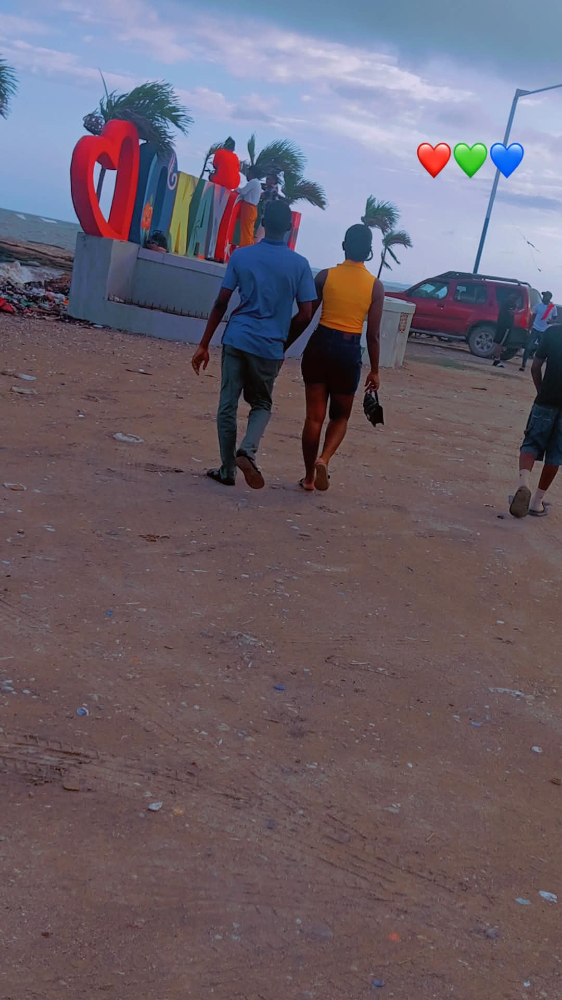
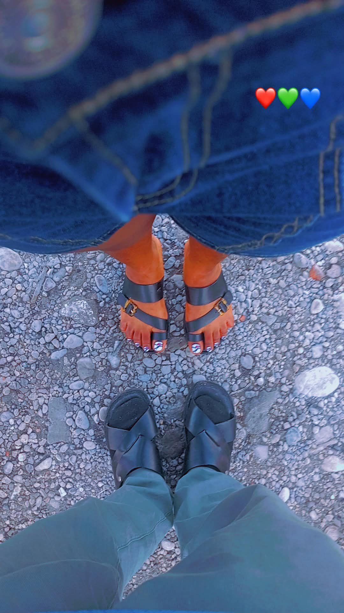
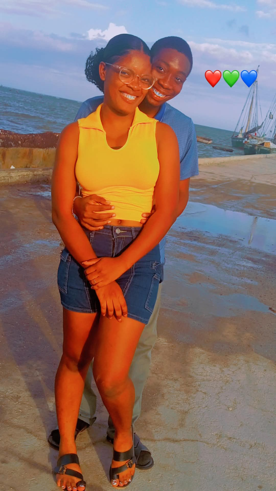

<meta charset="UTF-8">

<meta name="viewport" content="width=device-width, initial-scale=1.0">
<title>Shelby's Universe ❤️</title>

<body>

<header>
    <h1>Shelby's Universe ❤️</h1>
    
Un univers fait de souvenirs, d'amour et de rêves.

    
Bienvenue dans notre petit monde.

</header>

<nav>
    <a href="#about">À propos</a>
    <a href="#gallery">Galerie</a>
    <a href="#story">Notre histoire</a>
    <a href="#messages">Messages</a>
    <a href="#surprises">Surprise</a>
</nav>

<section id="about">
    <h2>✨ Bienvenue dans mon univers</h2>
    

        

            Certaines histoires ne sont pas écrites dans les livres.
            Elles se construisent avec des moments, des sourires,
            des souvenirs et des personnes qui deviennent spéciales.
        

        
Voici un petit univers qui nous ressemble. ❤️

    

</section>

<section>
    <h2>❤️ Notre compteur</h2>
    

        
Depuis le 10 juillet 2026, notre histoire avance...

        <h1 id="counter" style="color:#d9b66f;">Calcul...</h1>
        
jours de souvenirs et de complicité.

    

</section>

<section id="gallery">
    <h2>📸 Notre galerie</h2>
    
Quelques images pour conserver nos plus beaux souvenirs.

    

        

        

        

    

</section>

<!-- FENETRE D'AGRANDISSEMENT -->

    <button class="closePhoto"
            onclick="fermerPhoto()">×</button>

    

<section id="story">
    <h2>📖 Notre chronologie</h2>

    

        

            <strong>6 juillet 2026</strong>
            
Le départ de Port-au-Prince.

        

        

            <strong>7 juillet 2026</strong>
            
L'arrivée en province.

        

        

            <strong>10 juillet 2026 ❤️</strong>
            
Un moment particulier qui a marqué le début de notre histoire.

        

        

            <strong>À suivre...</strong>
            
Parce que notre histoire continue de s'écrire.

        

    

</section>

<section id="messages">
    <h2>💌 Un message pour toi</h2>

    

        
Clique pour découvrir un message...

        <button onclick="newMessage()">Découvrir un message ❤️</button>
    

</section>

<section id="surprises">
    <h2>🎁 Une petite surprise</h2>

    

        
Il y a parfois des choses qu'on ne découvre qu'en ouvrant...

        <button onclick="showSurprise()">Ouvrir ma surprise 🎁</button>
        

    

</section>

<section>
    <h2>🔐 Un petit espace secret</h2>

    

        
Entre le code pour découvrir un message spécial.

        <input type="password" id="secretCode" placeholder="Code secret">

         

        <button onclick="checkCode()">Déverrouiller ❤️</button>

        

    

</section>

<footer>
    
Créé avec ❤️ par Shelby.

    
Une histoire, des souvenirs, un univers.

</footer>

</body>
Nèg dous ou a 😇
